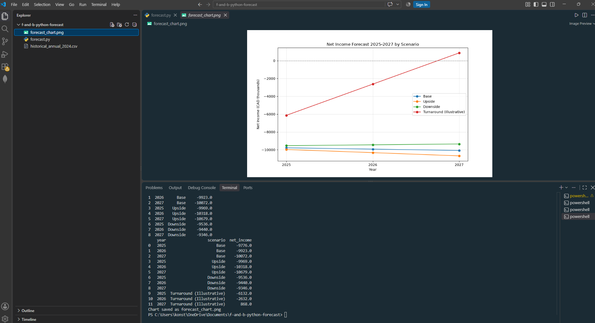
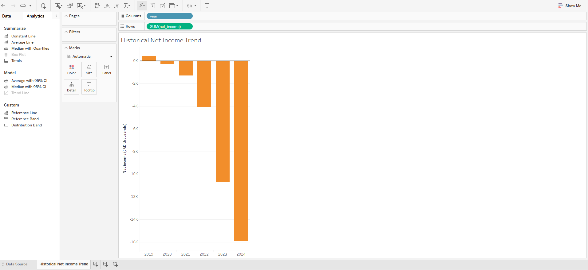
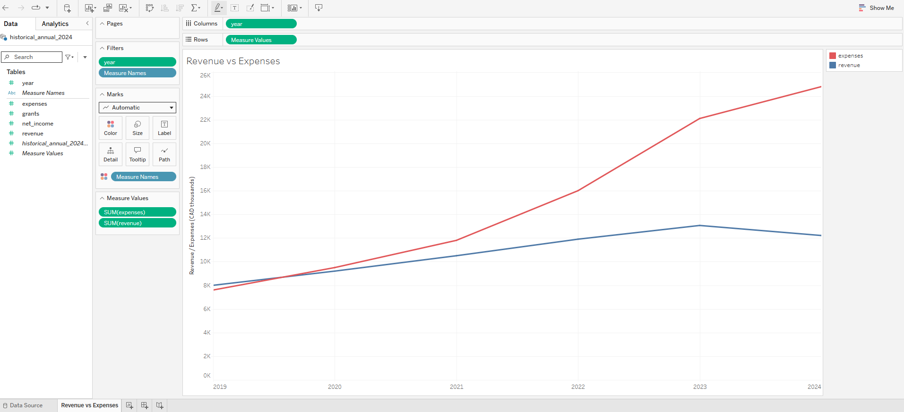
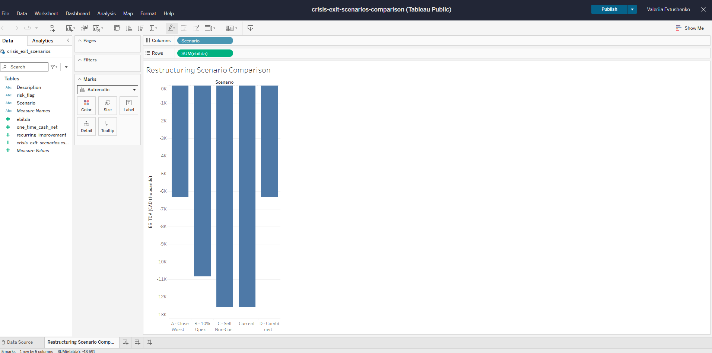

# Multi-Segment F&B Business — Financial Model & Restructuring Analysis

**Executive summary.** This portfolio project runs a full FP&A cycle on a synthetic multi-segment food-and-beverage business: data extraction and cleaning in SQL, a three-statement model in Excel, a driver-based forecast in Python, and interactive dashboards in Tableau. The conclusion is that the business is not self-sustaining, and that restructuring alone does not reach breakeven.

The project includes a three-statement financial model with a debt schedule and WACC-based valuation, scenario analysis, a SQL restructuring case study, a Python forecast to 2027, and four Tableau Public dashboards. Seven business segments.

> **All figures are in CAD thousands unless stated otherwise.**
> All data is synthetic, created for portfolio demonstration purposes.

Structured using the Ask → Prepare → Process → Analyze → Share → Act framework from the Google Data Analytics Certificate.

---

## Ask

Three business questions drove the analysis:

1. Is the business generating enough cash from operations?
2. Can the business repay its debt?
3. What happens if government grants are reduced or removed?

## Prepare

Data sources, all synthetic and generated for this portfolio:

- `financial_data_monthly` — monthly income statement and cash flow line items, 2023–2024
- `historical_annual` — annual net income, 2019–2024
- `segment_analysis_2024` — 2024 revenue, COGS, opex and net income by business segment

## Process

The raw BigQuery data had several quality issues, cleaned in SQL ([`sql/01_data_cleaning.sql`](sql/01_data_cleaning.sql)):

- a trailing space in the `Operating_Expenses` column name
- a typo in the `EBIDTA` column, renamed to `EBITDA`
- an auto-generated column name where BigQuery failed to parse a header

Further queries:

- [`sql/02_ebitda_correction.sql`](sql/02_ebitda_correction.sql) — corrects a mislabelled metric at segment level
- [`sql/03_crisis_exit_scenarios.sql`](sql/03_crisis_exit_scenarios.sql) — compares four restructuring options using CTEs
- [`sql/screenshots/`](sql/screenshots/) — workflow evidence for all SQL steps (01–10)

## Analyze

### 1. Three-statement model and valuation — [`excel-model/`](excel-model/)

Income statement, balance sheet and cash flow with a revolver and term-loan debt schedule, scenario drivers (Base, Upside, Downside) and a WACC-based NPV valuation.

**Modelling gap found and fixed.** Revolver interest was being calculated, but the circular-reference handling was not fully protected. Correcting the circularity switch revealed that interest expense had been understated by approximately 2,500. On the corrected model the revolver reaches its limit of 20,000 ($20.0M) in August 2024 — four months earlier than the uncorrected version showed — and the minimum cash covenant is breached for the remainder of the year.

### 2. Metric correction — [`sql/02_ebitda_correction.sql`](sql/02_ebitda_correction.sql)

A column named `net_income` at segment level was in fact EBITDA: revenue less COGS less opex, with nothing below the line. Renamed consistently across the SQL, the Excel model and the presentation, so that segment results are not read as net income.

### 3. Crisis exit scenarios — [`sql/03_crisis_exit_scenarios.sql`](sql/03_crisis_exit_scenarios.sql)

A CTE-based query comparing four restructuring options:

- closing underperforming segments
- cutting operating expenses
- selling non-core assets
- a combined approach

Recurring operating impact is separated explicitly from one-time cash effects. Assumptions for severance and for tax and transaction costs on asset sales are illustrative and disclosed in the query.

### 4. Forward-looking projection — [`python-forecast/forecast.py`](python-forecast/forecast.py)

A driver-based projection to 2025–2027 in Python (pandas, matplotlib).

**Method.** The projection combines the historical net income base — after depreciation and interest, before grants — with the EBITDA-level recurring improvement from the SQL scenarios. This is a simplification, disclosed in the code comments: a full re-run of depreciation, interest and grants under the restructured scenario was out of scope.

The model uses 24 months of monthly data (2023–2024). Because the business is in structural decline, driver-based assumptions were used rather than statistical trend-fitting: the historical trend does not reflect the restructuring actions tested in the SQL scenarios.

**Counterintuitive finding.** In this projection the Upside case, with higher revenue growth, produces a *worse* net income outcome than the Downside case. Percentage growth applied to an already-negative base means faster growth produces a faster-growing loss. This is why percentage-based growth assumptions are not meaningful for a loss-making business. Only the Turnaround scenario — a fixed annual improvement in absolute terms — reaches positive net income, at +868 by 2027.

This scenario is a Python-only extension, not part of the Excel model. Its purpose is to test what level of improvement would be required to reach breakeven.

### 5. Interactive dashboards — [`tableau-dashboard/`](tableau-dashboard/)

The historical trend, the revenue and expense comparison, the restructuring scenario comparison and the Python forecast, rebuilt as interactive Tableau Public visuals with hover tooltips and a zero reference line on the trend chart.

https://public.tableau.com/app/profile/valeriia.evtushenko/viz/FB-Revenue-vs-Expenses/RevenuevsExpenses

## Share

**Project structure**

- `excel-model/` — three-statement model, scenario drivers, debt schedule, WACC/NPV
- `presentation/` — case study slides
- `sql/` — BigQuery data cleaning, metric correction, scenario analysis
- `sql/screenshots/` — SQL workflow evidence (01–10)
- `python-forecast/` — 2025–2027 driver-based forecast (pandas, matplotlib)
- `python-forecast/screenshots/` — Python workflow evidence (py01–py04)
- `tableau-dashboard/data/` — CSV exports used for Tableau
- `tableau-dashboard/screenshots/` — Tableau workflow evidence (tb01–tb04)

**Live dashboards on Tableau Public**

- https://public.tableau.com/app/profile/valeriia.evtushenko/viz/HistoricalNetIncomeTrend/HistoricalNetIncomeTrend
- [Restructuring Scenario Comparison](TABLEAU_LINK_2)
- [Net Income Forecast 2025–2027 by Scenario](TABLEAU_LINK_3)

> The first link opens on the Historical Net Income Trend tab by default, a Tableau Public limitation with multi-tab workbooks. Use the tabs at the bottom of the visualisation to switch to Revenue vs Expenses.

## Act

**Findings**

**The business is not self-sustaining.** NPV remains negative at −21,294 (−$21.3M) across every tested combination of discount rate, from 5% to 25%, and government grant funding, from 0 to 2,400.

**There is a liquidity crisis, not a liquidity squeeze.** The revolving credit line reaches its limit of 20,000 in August 2024, after which the company breaches its minimum cash covenant for the rest of the year.

**The unprofitability is structural.** All seven segments are loss-making at EBITDA level. The Italian and Japanese restaurants are the largest loss drivers, and even the best-performing segment loses money.

**Restructuring is necessary but not sufficient.** Closing the two worst segments and selling non-core assets nearly closes the EBITDA gap, at +11,251 combined. Because of accumulated interest expense and fixed depreciation, that one-time improvement does not turn net income positive. Only a sustained improvement of roughly 3,500 a year — the Turnaround scenario — reaches breakeven by 2027.

**Recommendation.** Restructuring should proceed, but it should not be presented as the solution. Without an operational change in pricing or cost of sales, the business returns to the same position with a smaller footprint. The shortfall is structural, not cyclical.

## Tools

Google BigQuery (SQL) · Excel — three-statement modelling, WACC/NPV, scenario analysis, circular reference handling · Python (pandas, matplotlib) · Tableau Public · Canva

## Author

**Valeriia Evtushenko** — open to opportunities in financial analysis and FP&A.

[LinkedIn](https://www.linkedin.com/in/valeriia-evtushenko-51110a304)

© 2026 Valeriia Evtushenko. Portfolio use only.
